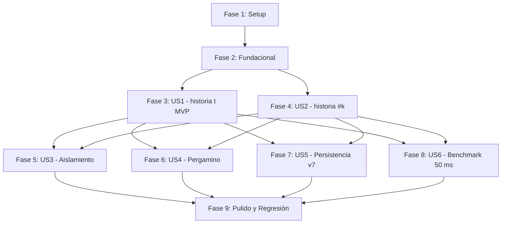

# Tareas: Línea de tiempo — consulta de estados pasados

**Entrada**: Documentos de diseño en `specs/004-linea-de-tiempo/` (`spec.md`, `plan.md`, `research.md`, `data-model.md`, `contracts/`, `quickstart.md`).  
**Prerrequisitos**: `plan.md` y `spec.md` aprobados.

## Formato: `- [ ] [ID] [P?] [Story?] Descripción con ruta de archivo`
- **[P]**: Ejecutable en paralelo (archivos independientes, sin dependencias bloqueantes).
- **[Story]**: Etiqueta obligatoria para historias de usuario (`[US1]`, `[US2]`, etc.). No aplica a Setup, Foundational ni Polish.
- Cada tarea cita rutas completas y exactas de los archivos afectados.

---

## Fase 1: Setup (Infraestructura y Verificación de Línea Base)

**Propósito**: Asegurar el entorno de pruebas y la estabilidad de la firma antes de implementar la lógica real.

- [X] T001 Verificar que `test_historia_firma.py` pasa hoy (línea base); se modificará en T009 para iniciar una partida antes de consultar
- [X] T002 [P] Confirmar la presencia y campos requeridos en `DTO/ResumenEstadoDTO.py` conforme a `data-model.md`

---

## Fase 2: Fundacional (Prerrequisitos Bloqueantes)

**Propósito**: Componentes estructurales base en la lógica del juego requeridos por todas las historias de usuario.

⚠️ **CRÍTICO**: Ninguna historia de usuario puede comenzar hasta completar esta fase.

- [X] T003 Implementar la búsqueda binaria manual por acciones `_buscarPuntoPorAcciones(self, k: int) -> PuntoControlDTO | None` y refactorizar `obtenerPuntoControlReciente` en `Logica/EstadoJuegoLogica.py` sin usar bibliotecas prohibidas (Principio I)
- [X] T004 [P] Implementar la búsqueda binaria manual por instante de reloj `_buscarPuntoPorInstante(self, t: int) -> PuntoControlDTO | None` en `Logica/EstadoJuegoLogica.py`
- [X] T005 Extraer la rutina común de empaquetado `_extraerResumenEstadoActual(self, instante: int, acciones: int) -> ResumenEstadoDTO` en `Logica/EstadoJuegoLogica.py` y refactorizar `_armarResultadoReplayHasta` para delegar en ella sin duplicar código
- [ ] T005b Corregir `_planificarSegmento` en `Logica/EstadoJuegoLogica.py` (plan.md §3, pasada 1): hoy usa `obtener_acciones_cronologicas()` (cadenas JSON, no `RegistroEvento`) y detecta el pergamino con una heurística sobre el texto del id; debe clasificar con `GestorEventos.es_uso_de_pergamino` al construir cada evento en una instancia aislada y devolver los índices vigentes con la pila local; test unitario propio con `A1 A2 A3 P A3' A4`
- [X] T006 Implementar el gestor de contexto / guarda en `Logica/EstadoJuegoLogica.py` para capturar y restituir los 8 atributos del singleton global `RetrocesoLogica` (`cabeza`, `cola`, `actual`, `reloj`, `cantidad_actual`, `cantidad_acciones`, `tiempo_evento`, `suspensiones`) y `reloj.retroceso` en un bloque `try ... finally`

**Punto de control**: Búsqueda binaria $O(\log M)$, extracción común y guarda de singleton listas y verificadas.

---

## Fase 3: User Story 1 - Consultar el estado por instante de reloj `historia <t>` (Prioridad: P1) 🎯 MVP

**Objetivo**: Permitir al jugador consultar el estado de la partida en cualquier instante $t$ pasado ($0 \le t \le T$) mediante el comando `historia <t>`.

**Criterio de prueba independiente**: Iniciar una partida, avanzar varias acciones con eventos simultáneos, consultar `historia <t>` y verificar que retorna el estado exacto tras todos los eventos con tiempo $\le t$ (excluyendo la decisión del jugador en $t$, FR-428), y que $t = 0$ devuelve el estado inicial (FR-430). Rechazar instantes futuros $t > T$ (FR-433) y formatos inválidos (FR-437).

### Pruebas para User Story 1
- [X] T007 [P] [US1] Crear pruebas unitarias para consulta por instante de reloj en `test_historia_tiempo.py` cubriendo FR-427, FR-428, FR-430, FR-433 y FR-437 (incluyendo corte en $t$ y desempate determinista)

### Implementación para User Story 1
- [X] T008 [US1] Implementar `_reconstruirHastaInstante(self, t: int) -> ResumenEstadoDTO` en `Logica/EstadoJuegoLogica.py`: `t ==` reloj vivo devuelve el estado vivo; si no, punto base con `_buscarPuntoPorInstante(t)`, pasada 2 fiel en la instancia aislada (revertidas y pergamino sin tope; vigentes con `tope=t`), parada evaluada solo tras acciones vigentes y luego `_completarInstante(t)`
- [X] T009 [US1] Conectar `consultarHistoria(instante=t)` en `Servicio/EstadoJuegoServicio.py`: validar `t >= 0`, rechazar bool y no enteros, y delegar a la lógica. Si la partida no está iniciada lanzar `ValueError("El juego no ha sido iniciado")` (no devolver datos de prueba) y actualizar `test_historia_firma.py` para iniciar una partida antes de consultar
- [X] T010 [P] [US1] Implementar el método de visualización `mostrar_historia(self, resumen: ResumenEstadoDTO)` en `Controlador/Vista.py` mostrando sala, vida, estadísticas, llaves, objetos, efectos y enemigos con vida, omitiendo el mapa si es `None` (FR-431)
- [X] T011 [US1] Incorporar la interpretación de `historia <t>` e `historia t` en `Controlador/ControladorJuego.py` antes de `_mapear_entrada_a_evento`, manejando mensajes de error descriptivos sin alterar el estado de la partida
- [X] T012 [US1] Habilitar la consulta de `historia <t>` en el bucle post-partida concluida (victoria o derrota) en `Controlador/ControladorJuego.py` (FR-427)

**Punto de control**: US1 es plenamente funcional de forma interactiva y en pruebas automatizadas.

---

## Fase 4: User Story 2 - Consultar el estado por número de acción `historia #k` (Prioridad: P1)

**Objetivo**: Permitir al jugador consultar el estado de la partida justo antes de tomar la acción número $k$ de la línea vigente mediante `historia #k`.

**Criterio de prueba independiente**: Ejecutar $N$ acciones numeradas; verificar que `historia #k` devuelve el estado antes de la acción $k$, que `historia #1` coincide con el estado inicial (`historia 0`), que `historia #(N+1)` devuelve el estado actual, y que $k \le 0$ o $k > N+1$ se rechazan con mensaje claro.

### Pruebas para User Story 2
- [X] T013 [P] [US2] Crear pruebas unitarias para consulta por número de acción en `test_historia_accion.py` cubriendo FR-429, FR-430, FR-435, FR-436 y equivalencia con `historia <t>` (SC-002)

### Implementación para User Story 2
- [X] T014 [US2] Implementar `_reconstruirHastaAccion(self, k: int) -> ResumenEstadoDTO` en `Logica/EstadoJuegoLogica.py`: punto base con `_buscarPuntoPorAcciones(k-1)`, `j = (k-1) - c`, pasada 2 fiel parando justo antes de aplicar la acción vigente `E[j]`
- [X] T015 [US2] Conectar `consultarHistoria(accion=k)` en `Servicio/EstadoJuegoServicio.py`, validando $k \ge 1$ (rechazando $k=0$ y negativos con `ValueError`, FR-435), verificando $k \le N + 1$ (FR-436) y resolviendo $k = N + 1$ retornando el estado actual
- [X] T016 [US2] Incorporar la interpretación de `historia #k` en `Controlador/ControladorJuego.py` en la partida interactiva y en el bucle post-partida, manejando errores descriptivos
- [X] T017 [US2] Validar en `Logica/EstadoJuegoLogica.py` y `Servicio/EstadoJuegoServicio.py` el caso de partida sin acciones ($N=0$): `#1` y `0` devuelven estado inicial, $t > 0$ y $k > 1$ se rechazan (FR-438)

**Punto de control**: US2 es plenamente funcional y equivalente a US1 para instantes coincidentes.

---

## Fase 5: User Story 3 - La consulta no altera la partida en curso (Prioridad: P1)

**Objetivo**: Garantizar el aislamiento riguroso: la consulta no consume tiempo virtual, no cuenta como acción, no escribe en el log ni en disco, no modifica el generador de azar ni el pergamino y no consume solicitudes de red.

**Criterio de prueba independiente**: Medir `reloj.tiempo_actual`, `acciones_linea_tiempo`, longitud de bitácora, longitud de log, estado de `azar.getstate()`, solicitudes de red y cambios en `RetrocesoLogica` antes y después de múltiples consultas intercaladas, verificando que son idénticos bit a bit (FR-432, FR-440, SC-005).

### Pruebas para User Story 3
- [ ] T018 [P] [US3] Crear archivo de pruebas de aislamiento `test_historia_aislamiento.py` con pruebas para invariancia de reloj, bitácora, log en disco, solicitudes de red y estado del generador de azar (FR-432, FR-440, Apéndice B Caso 4)

### Implementación para User Story 3
- [ ] T019 [US3] Asegurar en `Logica/EstadoJuegoLogica.py` que la instancia aislada opere con `registrador_log = None` y `_es_repeticion = True`, inhibiendo capturas de checkpoint y registros de puntaje
- [ ] T020 [US3] Verificar en `Logica/EstadoJuegoLogica.py` que la instancia aislada no realice peticiones a la red pasando `pedir_llaves=False` y apoyándose en la caché ya precargada del adaptador `comunicacion`

**Punto de control**: Aislamiento validado: cero efectos colaterales en la partida viva.

---

## Fase 6: User Story 4 - Coherencia con el pergamino de retroceso (Prioridad: P2)

**Objetivo**: Mantener la coherencia de la línea de tiempo tras usar un pergamino de retroceso: las acciones revertidas desaparecen de la historia y el historial del pergamino sigue funcionando con normalidad tras cualquier consulta.

**Criterio de prueba independiente**: Jugar 10 acciones, revertir 3 con el pergamino, consultar `historia #k` y `historia <t>`, comprobar que las acciones revertidas no aparecen (FR-434, Apéndice B Caso 2), y verificar que usar otro pergamino posterior desapila correctamente sin corrupción de `RetrocesoLogica`.

### Pruebas para User Story 4
- [ ] T021 [P] [US4] Agregar pruebas de coherencia con pergamino en `test_historia_aislamiento.py` cubriendo poda de puntos de control, invisibilidad de ramas revertidas y uso de pergamino inmediatamente después de una consulta `historia`

### Implementación para User Story 4
- [ ] T022 [US4] Probar en `test_historia_aislamiento.py` el caso `A1 A2 A3 P A3' A4` (consulta `#4` = estado tras `A3'`, no tras `A3`), pergamino justo después de un punto de control, y que el azar de la partida viva sigue idéntico: el log NO se trunca, la línea vigente sale de la pila de `_planificarSegmento`
- [ ] T023 [US4] Asegurar que la restitución de atributos de `RetrocesoLogica` en `Logica/EstadoJuegoLogica.py` conserve íntegro el puntero `reloj.retroceso` de la partida viva para usos subsecuentes del pergamino

**Punto de control**: Coherencia y compatibilidad total con el pergamino de retroceso confirmada.

---

## Fase 7: User Story 5 - Persistencia: guardar y cargar conserva la línea de tiempo (Prioridad: P2)

**Objetivo**: Asegurar que una partida guardada y vuelta a cargar (formato binario v7) responda a las consultas `historia` de forma idéntica a la sesión original.

**Criterio de prueba independiente**: Jugar una partida con puntos de control periódicos, ejecutar consultas de historia, guardar con `guardarPartida()`, cargar con `cargarPartida()` en una nueva instancia y comprobar que las mismas consultas producen resultados idénticos (FR-441, Apéndice B Caso 6).

### Pruebas para User Story 5
- [ ] T024 [P] [US5] Agregar pruebas de persistencia en `test_historia_aislamiento.py` verificando guardar/cargar en formato v7 y reproducibilidad exacta de consultas históricas

### Implementación para User Story 5
- [ ] T025 [US5] Verificar en `Logica/EstadoJuegoLogica.py` y `Servicio/EstadoJuegoServicio.py` que `cargarPartida` reconstruye adecuadamente `puntos_control`, `acciones_linea_tiempo` y el historial cronológico del log necesario para `consultarHistoria`

**Punto de control**: Persistencia v7 validada sin necesidad de modificar el formato binario de archivo.

---

## Fase 8: User Story 6 - Rendimiento: la consulta responde en tiempo acotado (Prioridad: P2)

**Objetivo**: Garantizar que `historia <t>` e `historia #k` respondan en $\le 50$ ms en partidas de al menos 5 000 acciones del jugador con el $K$ por defecto, y documentar la comparación frente a las alternativas descartadas en `--bench`.

**Criterio de prueba independiente**: Ejecutar `python main.py --bench historia` sobre cripta sintética con 5 000 acciones y comprobar que el tiempo máximo es $\le 50$ ms, que el costo crece como máximo con $K-1$, y que la reconstrucción desde puntos es significativamente más rápida que la Alternativa C (desde el inicio).

### Implementación para User Story 6
- [ ] T026 [P] [US6] Crear el módulo de benchmark `bench/historia.py` siguiendo las pautas de `bench/puntos_control.py` (con `gc.disable()` durante las mediciones), evaluando partidas de $\ge 5\,000$ acciones con $K \in \{10, 50, 100\}$ y midiendo el peor caso ($K-1$ acciones desde el punto)
- [ ] T027 [US6] Incluir en `bench/historia.py` la medición de la Alternativa C descartada (reconstrucción desde el inicio sin checkpoints) y el reporte comparativo del tiempo de búsqueda binaria vs. búsqueda lineal
- [ ] T028 [US6] Registrar el bloque `("historia", historia.ejecutar)` en `bench/__init__.py` y verificar su integración con la opción `--bench historia` en `main.py`
- [ ] T029 [P] [US6] Crear prueba automatizada para el benchmark en `bench/test_bench_historia.py` verificando que el módulo `bench/historia.py` ejecuta sin errores y cumple los límites

**Punto de control**: Requisito de rendimiento FR-442 ($\le 50$ ms) y Principio VII respaldados con mediciones empíricas.

---

## Fase 9: Pulido y Verificaciones Cruzadas

**Propósito**: Consolidación final de calidad, pruebas de regresión completa y cumplimiento constitucional.

- [ ] T030 Ejecutar la suite completa de pruebas unitarias de la raíz (`test_historia_firma.py`, `test_historia_tiempo.py`, `test_historia_aislamiento.py`, `test_puntos_control.py`, `test_replay_hasta.py`) y corregir cualquier regresión
- [ ] T031 Ejecutar la validación interactiva manual siguiendo los pasos de `quickstart.md`
- [ ] T033 Actualizar `DECISIONES.md` (sección 004: K por defecto con números medidos por `bench/historia.py`, búsqueda binaria vs lineal, reconstrucción hacia adelante vs hacia atrás), agregar las filas de `PROMPTS_LLM_JP.md` con herramienta y modelo reales, y confirmar a Fernanda que `consultarHistoria` ya no devuelve datos de prueba
- [ ] T032 Verificar el cumplimiento estricto del Principio I de la Constitución (auditar que no existan importaciones de `bisect`, `dict`/`set` como índice ni `collections` en el código nuevo)

---

## Dependencias y Orden de Ejecución

### Dependencias entre fases
- **Fase 1 (Setup)**: Sin dependencias, inicio inmediato.
- **Fase 2 (Fundacional)**: Depende de Fase 1. **BLOQUEA** todas las historias de usuario.
- **Fase 3 (US1 - MVP)**: Depende de Fase 2. Establece la reconstrucción temporal base y el comando de consola.
- **Fase 4 (US2)**: Depende de Fase 2 y reutiliza la infraestructura de US1.
- **Fase 5 (US3)**: Depende de US1 y US2 (valida el aislamiento de ambas).
- **Fase 6 (US4)**: Depende de US1 y US2 (valida interacción con pergamino).
- **Fase 7 (US5)**: Depende de US1 y US2 (valida persistencia v7).
- **Fase 8 (US6)**: Depende de US1 y US2 (mide rendimiento con 5 000 acciones).
- **Fase 9 (Pulido)**: Depende de completar todas las fases anteriores.

---

## Oportunidades de Ejecución en Paralelo

- **Fase 2**: T004 (`_buscarPuntoPorInstante`) puede desarrollarse en paralelo con T003 (`_buscarPuntoPorAcciones`).
- **Fase 3 (US1)**: T007 (pruebas) y T010 (vista) pueden implementarse en paralelo con T008 (lógica).
- **Fase 4 (US2)**: T013 (pruebas) puede implementarse en paralelo con T014 (lógica).
- **Historias P2 (Fases 5, 6, 7 y 8)**: Una vez completadas US1 y US2, las fases de aislamiento (Fase 5), pergamino (Fase 6), persistencia (Fase 7) y benchmarks (Fase 8) pueden implementarse y verificarse en paralelo al atacar distintos archivos de pruebas y submódulos.

---

## Estrategia de Implementación

### Alcance MVP (Fases 1, 2 y 3)
1. Completar Setup y Fundacional (Fases 1 y 2): Búsqueda binaria manual, extracción común y guarda de singleton.
2. Completar US1 (Fase 3): Consulta por instante de reloj `historia <t>` con visualización y manejo de errores.
3. **Punto de validación MVP**: Ejecutar `test_historia_tiempo.py` enfocado en US1 para demostrar consulta histórica funcional sin tocar la partida viva.

### Entrega Incremental
1. Añadir US2 (Fase 4): Consulta por número de acción `historia #k` y equivalencia temporal.
2. Añadir US3 (Fase 5): Verificación exhaustiva de aislamiento absoluto.
3. Añadir US4 (Fase 6): Integración con podas de pergamino y consistencia de línea vigente.
4. Añadir US5 (Fase 7): Pruebas de guardado y carga en formato binario v7.
5. Añadir US6 (Fase 8): Medición de límite de 50 ms en `--bench historia` y contraste con alternativas descartadas.
6. Fase 9: Pulido, verificación constitucional y ejecución completa de la suite de pruebas.
