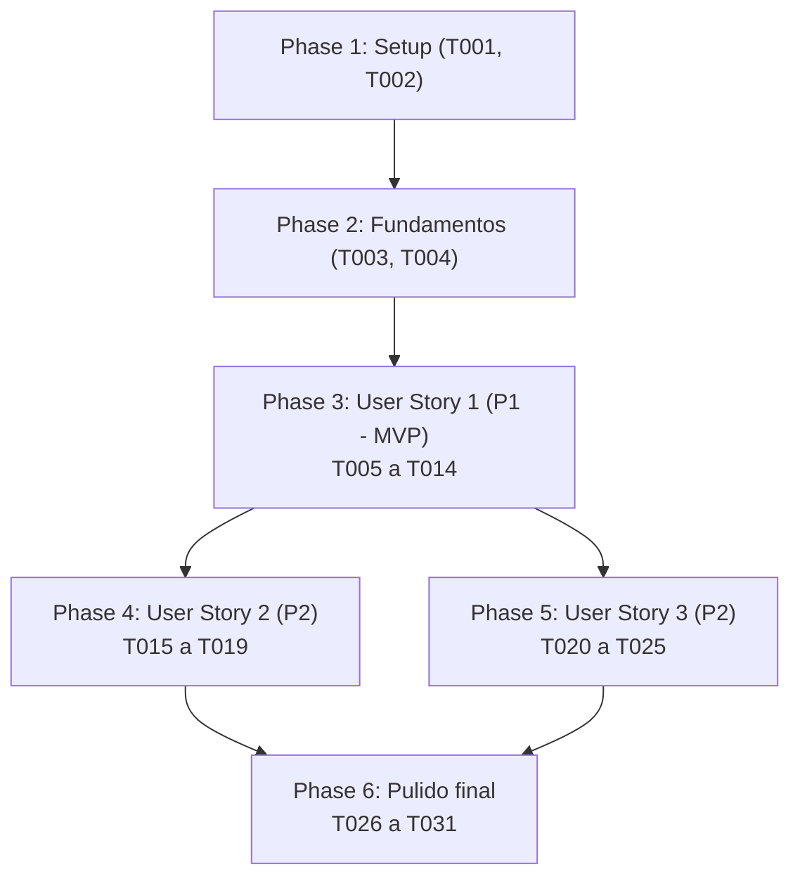

# Tareas: Reproducir partida grabada hasta un instante dado (replay-hasta)

**Entrada**: documentos de diseño en `specs/008-replay-hasta/` (`plan.md`, `spec.md`, `research.md`, `data-model.md`, `contracts/`, `quickstart.md`).

**Prerrequisitos**: `plan.md` y `spec.md` (con las clarificaciones de corte inclusivo $\le t$ y reporte exhaustivo de estado). La capacidad se construye sobre el código existente de la Parte I: `main.py`, `Servicio/EstadoJuegoServicio.py`, `Logica/EstadoJuegoLogica.py` y `Logica/RelojVirtual.py`.

**Pruebas**: Se incluyen en todas las historias porque la constitución (principio IX) exige que cada escenario de aceptación tenga una prueba automatizada. Cada prueba se escribe **antes** del código y debe fallar primero.

**Organización**: Tareas agrupadas por historia de usuario. Cada tarea indica entre paréntesis los requisitos que atiende.

## Formato: `[ID] [P?] [Historia] Descripción con ruta`

- **[P]**: Se puede ejecutar en paralelo (archivos distintos, sin dependencia de tareas incompletas).
- **[USn]**: Historia de `spec.md` a la que pertenece ([US1], [US2], [US3]).
- Las rutas son relativas a la raíz del repositorio. Las pruebas usan `unittest` (`test_*.py` en la raíz).

## Reglas para todas las tareas (constitución)

- **No usar** `dict` ni `set` como índice, caché o tabla de búsqueda; ni `heapq`, `bisect`, `collections` (`deque`, `OrderedDict`, `defaultdict`, `Counter`), `networkx` ni bibliotecas de grafos. Se permiten `list`, `struct`, `json`, `requests` y dataclasses.
- Ningún id de sala o entidad, cantidad de páginas, presupuesto ni estadística de una cripta concreta en el código de producción (Principio V).
- El modelo (`Logica/`, `DTO/`) no importa red, disco ni vista ni escribe en la consola (Principio IV).
- Las opciones `--replay` y `--bench` no instancian la vista interactiva (Principio IV, FR-410).
- La reproducción de un log no genera un nuevo archivo de registro ni registra puntajes (FR-410).

---

## Phase 1: Setup (Shared Infrastructure)

**Propósito**: Material de soporte de pruebas y verificación constitucional.

- [ ] T001 Revisar `plan.md` y este `tasks.md` contra la lista de estructuras prohibidas del principio I de la constitución (sin `heapq`, `bisect`, `collections`, `networkx` ni `dict`/`set` como índice/caché) y anotar el resultado en `specs/008-replay-hasta/checklists/requirements.md`. (Principio I)
- [ ] T002 [P] Crear el generador determinista de partidas sintéticas en `tests_labs/generador_partidas.py` para construir archivos de log reproducibles por semilla (`semilla=2026`) con longitudes parametrizables (250, 1 000 y 4 000 acciones), conteniendo cabeceras de versión, acciones con costo temporal y movimientos de cursor de inventario para pruebas y benchmarks. (FR-411, FR-412, FR-413)

**Punto de control**: Verificación de estructuras anotada y generador sintético disponible para las pruebas.

---

## Phase 2: Foundational (Blocking Prerequisites)

**Propósito**: Componentes base de datos y validación de tipos requeridos por todas las historias de usuario.

- [ ] T003 [P] Crear `DTO/ResultadoReplayHastaDTO.py` con los campos exactos de `data-model.md`: `instante_pedido: int`, `instante_alcanzado: int`, `acciones_reproducidas: int`, `id_sala_jugador: int`, `vida_jugador: int`, `ataque_jugador: int`, `defensa_jugador: int`, `velocidad_jugador: int`, `inventario_llaves: list[str]`, `inventario_objetos: list[str]`, `efectos_activos: list[str]`, `enemigos_sala: list[tuple[str, str, int]]` (id de instancia, nombre, vida), `partida_terminada: bool = False`, `motivo_terminacion: str | None = None` y `log_agotado: bool = False`. (FR-404, Principio I, Principio IV)
- [ ] T004 [P] Implementar la función validadora `_instante_hasta(texto: str) -> int` en `main.py` según `contracts/argumento-hasta.md`, validando conversión a entero y rechazando valores negativos con `argparse.ArgumentTypeError("el instante virtual debe ser mayor o igual que 0")`. (FR-407)

**Punto de control**: `ResultadoReplayHastaDTO` importable y función validadora lista.

---

## Phase 3: User Story 1 — Reproducción acotada hasta un instante intermedio (Priority: P1) 🎯 MVP

**Meta**: Ejecutar `--replay PARTIDA.log --hasta t` reproduciendo únicamente los eventos con tiempo virtual $\le t$, deteniendo la simulación en $t$ e informando el estado exhaustivo en dicho instante.

**Prueba independiente**: Ejecutar la reproducción con un valor intermedio de $t$ sobre un log conocido; comprobar que los eventos posteriores a $t$ no ocurren y que el estado emitido corresponde exactamente al momento del corte.

### Pruebas para User Story 1 (escribir primero; deben fallar)

- [ ] T005 [P] [US1] Crear `test_replay_hasta.py` con la clase `TestTruncamientoTemporal`: verificar que `_avanzarHastaProximoTurno(tope)` no desapila eventos con `tiempo_ejecucion > tope`, incluido un `TURNO_JUGADOR` posterior que permanece en el reloj (FR-402); que se ejecutan todos los eventos de otros actores con `tiempo_ejecucion == tope` aunque su número de secuencia sea posterior al turno del jugador, mediante `_completarInstante` (FR-403); que la decisión del jugador cuyo instante es igual a `tope` no se ejecuta (FR-403, Apéndice B); y que una acción del jugador anterior a `tope` se ejecuta completa aunque su costo la lleve más allá de `tope`. (FR-402, FR-403)
- [ ] T006 [P] [US1] Agregar a `test_replay_hasta.py` la clase `TestEstadoReportado`: verificar que `repetirPartida(log, hasta=t)` interrumpe la lectura del log al alcanzar el tope y entrega un `ResultadoReplayHastaDTO` conteniendo: instante pedido, instante alcanzado $\le t$, cantidad de acciones del jugador ejecutadas, sala actual, vida y estadísticas vigentes, llaves y objetos en inventario, efectos activos, lista ordenada de enemigos vivos en la sala con su id de instancia, nombre y vida (con dos enemigos del mismo tipo se distinguen por id) y estado de la partida en curso. (FR-401, FR-404)
- [ ] T007 [P] [US1] Agregar a `test_replay_hasta.py` la clase `TestCasosLimite`: verificar que con $t=0$ no se ejecuta ninguna acción del log y se retorna el estado inicial con 0 acciones reproducidas, como consecuencia de la regla de FR-403 y sin caso especial (FR-406); que si el registro se agota o la partida termina en un instante estrictamente menor que $t$ se reproduce todo el archivo y se reporta `log_agotado=True` o `partida_terminada=True` con su motivo (FR-405); que si la partida termina exactamente en $t$ se informa el estado final sin el aviso de «antes de alcanzar t»; y que si el jugador muere antes de alcanzar $t$ el reloj se congela en el instante de la muerte. (FR-404, FR-405, FR-406)

### Implementación de User Story 1

- [ ] T008 [US1] Modificar `_avanzarHastaProximoTurno(self, tope: int | None = None)` en `Logica/EstadoJuegoLogica.py` según `research.md`: antes de desapilar el siguiente evento del reloj, si `siguiente.tiempo_ejecucion > tope` interrumpir con `break` (también para un `TURNO_JUGADOR` posterior); si `siguiente.tiempo_ejecucion <= tope` desapilar y procesar. Extraer el cuerpo de procesamiento de un evento a un método auxiliar compartido e implementar `_completarInstante(self, hasta: int)`, que ejecuta con ese mismo cuerpo los eventos restantes con `tiempo_ejecucion == hasta` y nunca una decisión del jugador. Con `tope is None` el comportamiento no cambia. (FR-402, FR-403, FR-409)
- [ ] T009 [US1] Modificar `accionJugador(self, evento: EventoDTO, tope: int | None = None)` en `Logica/EstadoJuegoLogica.py` para recibir el parámetro opcional `tope` y propagarlo a la llamada `self._avanzarHastaProximoTurno(tope=tope)`. (FR-401, FR-402)
- [ ] T010 [US1] Implementar el método privado `_armarResultadoReplayHasta(self, hasta: int, acciones_reproducidas: int, log_agotado: bool) -> ResultadoReplayHastaDTO` en `Logica/EstadoJuegoLogica.py`: recopilar `instante_pedido` (`hasta`), `instante_alcanzado` (`self.estadoJuego.reloj.tiempo_actual`), `acciones_reproducidas`, sala, vida y estadísticas vigentes del jugador, llaves, objetos del inventario, efectos activos (veneno, velocidad temporal, antorcha encendida) en orden fijo, lista ordenada por id de instancia de tuplas `(id_instancia, nombre, vida)` de enemigos vivos en la sala actual, `partida_terminada` (`self.fin`), motivo de terminación y bandera `log_agotado`. No incluye el mapa conocido (diferido, `spec.md` Assumptions). (FR-404, FR-405, Principio II, Principio IV)
- [ ] T011 [US1] Adaptar `repetirPartida(self, log: LogPartidaDTO, hasta: int | None = None)` en `Logica/EstadoJuegoLogica.py`: si `hasta is not None`, antes de tomar cada registro del log (acción con costo, movimiento de cursor de inventario o pergamino) comprobar `reloj.tiempo_actual < hasta` y detener la lectura si no se cumple, de modo que $t=0$ no ejecute ninguna acción sin regla especial (FR-403, FR-406); pasar `tope=hasta` a `accionJugador`; interrumpir si `self.fin` es verdadero; al detenerse llamar a `_completarInstante(hasta)` cuando el reloj quedó exactamente en `hasta`; marcar `log_agotado=True` si el log se agota con el reloj estrictamente antes de `hasta` y sin terminar la partida; y retornar `ResultadoReplayHastaDTO`. (FR-401, FR-402, FR-403, FR-404, FR-405, FR-406) FR-406 se mantiene como requisito de frontera, pero el código no incluye ninguna rama `if hasta == 0`: el caso $t=0$ lo resuelve la misma comprobación `reloj.tiempo_actual < hasta`.
- [ ] T012 [US1] Adaptar `repetirPartida(self, archivo: str, hasta: int | None = None)` en `Servicio/EstadoJuegoServicio.py` para recibir el parámetro `hasta` y pasarlo a `self._estadoJuegoLogica.repetirPartida(log, hasta=hasta)`. (FR-401, FR-404)
- [ ] T013 [US1] Modificar `main.py`: añadir el argumento `--hasta` con `type=_instante_hasta` en `leer_argumentos()`, adaptar `reproducir(servicio, archivo, hasta=None)` para invocar `servicio.repetirPartida(nombre, hasta=hasta)`, y presentar en consola el texto formateado de `ResultadoReplayHastaDTO` según `contracts/salida-texto.md` (incluidos estadísticas y efectos activos, y el aviso de «antes de alcanzar t» solo cuando `instante_alcanzado < instante_pedido`). (FR-401, FR-404, FR-405, FR-406, Principio IV)
- [ ] T014 [US1] Ejecutar `python -m unittest test_replay_hasta` y comprobar que todos los escenarios de la Historia 1 pasan exitosamente. (FR-401 a FR-406)

**Punto de control**: La Historia 1 (MVP) funciona y pasa sus pruebas unitarias e integradas de forma independiente.

---

## Phase 4: User Story 2 — Validación de parámetros y preservación del comportamiento base (Priority: P2)

**Meta**: Validar robustamente los argumentos CLI de `--hasta` antes de crear servicios ni tocar disco, y garantizar paridad exacta de `--replay` sin `--hasta`.

**Prueba independiente**: Ejecutar comandos con argumentos inválidos comprobando rechazo inmediato; ejecutar `--replay` solo comprobando paridad exacta de salida y ausencia de efectos colaterales (sin vista, sin log nuevo, sin puntajes).

### Pruebas para User Story 2 (escribir primero; deben fallar)

- [ ] T015 [P] [US2] Agregar a `test_replay_hasta.py` la clase `TestArgumentosCLI`: comprobar que un valor de $t$ negativo (ej. `-5`) es rechazado con código de salida 2 y mensaje de `_instante_hasta` (FR-407); comprobar que un valor no entero (ej. `"abc"`) es rechazado con código 2 (FR-407); y comprobar que invocar `--hasta` sin `--replay` termina con código 2 y emite en `stderr` el mensaje `Error: el argumento --hasta requiere especificar una partida con --replay.` (FR-408). Además, medir con `time.perf_counter()` el tiempo de cada invocación inválida (valor negativo, no entero y `--hasta` sin `--replay`, ejecutadas en el mismo proceso) y afirmar que es menor que 0,1 s, para certificar SC-004. (FR-407, FR-408, SC-004)
- [ ] T016 [P] [US2] Agregar a `test_replay_hasta.py` la clase `TestCompatibilidadReplay`: verificar que invocar `--replay PARTIDA.log` sin `--hasta` devuelve `list[ResultadoEventoDTO]` y emite la salida estándar clásica sin cambios (FR-409); y clase `TestAislamientoReplay`: comprobar que la reproducción acotada no inicializa componentes gráficos, no escribe nuevos archivos en `logs/` ni modifica la tabla de puntajes persistida. (FR-409, FR-410)

### Implementación de User Story 2

- [ ] T017 [US2] En `main.py`, incorporar la validación de precedencia en `main(argv)` / `leer_argumentos(argv)`: si `args.hasta is not None and not args.replay`, imprimir en `sys.stderr` el error `Error: el argumento --hasta requiere especificar una partida con --replay.` y finalizar con código 2 antes de crear `EstadoJuegoServicio`. (FR-407, FR-408, Principio IV)
- [ ] T018 [US2] Asegurar en `main.py` que si `args.hasta is None`, la función `reproducir()` preserva carácter por carácter el formato original: `\nReproducción terminada: {N} acciones del jugador.` seguido de `Estado final: {motivo}` o `La partida no había terminado al acabarse el log.` (FR-409, FR-410)
- [ ] T019 [US2] Ejecutar `python -m unittest test_replay_hasta` verificando que las pruebas de `TestArgumentosCLI`, `TestCompatibilidadReplay` y `TestAislamientoReplay` pasen en su totalidad. (FR-407 a FR-410)

**Punto de control**: Validaciones de línea de comandos robustas y compatibilidad regresiva comprobada.

---

## Phase 5: User Story 3 — Determinismo estricto y rendimiento proporcional (Priority: P2)

**Meta**: Demostrar que dos ejecuciones con mismo log y mismo $t$ producen resultados idénticos, que la reproducción acotada equivale a la propiedad de prefijo, y medir con `--bench replay` que el costo es proporcional al tiempo reproducido.

**Prueba independiente**: Ejecutar dos reproducciones independientes sobre el mismo archivo comparando el DTO; comparar el prefijo contra la partida completa; y ejecutar el bloque de benchmark `replay` verificando el conteo de eventos.

### Pruebas para User Story 3 (escribir primero; deben fallar)

- [ ] T020 [P] [US3] Crear `test_determinismo_replay.py`: verificar que dos ejecuciones sucesivas con la misma cripta, semilla y valor de $t$ generan idéntico `ResultadoReplayHastaDTO` y texto de salida carácter por carácter (FR-411); y verificar la propiedad de prefijo demostrando que el estado informado al reproducir hasta $t$ coincide con el estado que tenía la reproducción completa del log en el instante $t$ (estado justo antes de la decisión del jugador en $t$, si la hay). (FR-411)
- [ ] T021 [P] [US3] Crear `test_rendimiento_replay.py`: verificar con logs sintéticos generados por `generador_partidas.py` (de 250, 1 000 y 4 000 acciones) que la cantidad de eventos procesados para $t = T / 2$ es estrictamente $\le 0.55 \times \text{eventos totales}$, demostrando que el costo no depende de las acciones posteriores a $t$. (FR-412)
- [ ] T022 [P] [US3] Crear `bench/test_bench_replay.py`: verificar que la ejecución programática de `bench.replay.ejecutar` procesa las cargas sintéticas, reporta las secciones A y B según `contracts/bench-replay.md` y exporta correctamente a CSV cuando se solicita. (FR-412, FR-413, Principio VII)

### Implementación de User Story 3

- [ ] T023 [US3] Implementar el módulo `bench/replay.py` según `contracts/bench-replay.md`:
  - Sección A: Proporcionalidad temporal de la Opción b (tope en el ciclo) en partidas de 250, 1 000 y 4 000 acciones para $t = T/2$ vs. reproducción total, reportando eventos procesados, razón de eventos y tiempos en ms. (FR-412, FR-413)
  - Sección B: Comparativa con alternativa a (corte solo entre acciones de jugador) y alternativa c (reproducción total y recorte de estado), demostrando que la Opción b es la única que cumple fidelidad temporal y corte efectivo de eventos. (FR-412, Principio VII)
  - Sección C: Verificación determinista de salida idéntica en repeticiones consecutivas. (FR-411)
- [ ] T024 [US3] Registrar el bloque `("replay", replay.ejecutar)` en `BLOQUES` de `bench/__init__.py` y actualizar la descripción de bloques disponibles en `main.py`. (FR-413)
- [ ] T025 [US3] Ejecutar `python -m unittest test_determinismo_replay test_rendimiento_replay bench.test_bench_replay` y correr `python main.py --bench replay` verificando que se cumplen todos los criterios duros de conteo de eventos. (FR-411, FR-412, FR-413)

**Punto de control**: Determinismo verificado, proporcionalidad demostrada y benchmark `replay` operativo.

---

## Phase 6: Polish & Cross-Cutting Concerns

**Propósito**: Validaciones integrales finales, mediciones definitivas y documentación.

- [ ] T026 [P] Ejecutar la suite completa de pruebas del repositorio con `python -m unittest discover -p "test_*.py"` comprobando que no existan regresiones en Parte I ni en capacidades 001 y 005.
- [ ] T027 Ejecutar `python main.py --bench replay --bench-csv bench_replay_resultados.csv` y registrar los resultados en `specs/008-replay-hasta/mediciones.md`. (Principio VII)
- [ ] T028 Ejecutar las pruebas manuales de consola descritas en `quickstart.md` §3 comprobando los mensajes exactos de error y formatos de salida para `--hasta`.
- [ ] T029 Actualizar `DECISIONES.md` documentando la ratificación de la Opción b respaldada por los resultados empíricos de `--bench replay`. (Principio VII)
- [ ] T030 Actualizar `README.md` con el comando `python main.py --replay NOMBRE.log --hasta T` (qué hace y qué muestra), las pruebas de aceptación de esta capacidad (`python -m unittest test_replay_hasta test_determinismo_replay test_rendimiento_replay`) y el agente de Spec Kit realmente usado. (FR-401, FR-409; enunciado §7.2)
- [ ] T031 Registrar en `PROMPTS_LLM.md` una fila por cada comando `/speckit-…` con texto propio de esta capacidad (specify, clarify, el prompt de corrección de la especificación, plan, tasks, analyze, el prompt de alineación y, al ejecutarlos, implement), con herramienta, modelo y fecha, y no en archivos separados. (Principio XI)

---

## Dependencies & Execution Order

### Phase Dependencies

- **Setup (Phase 1)**: Sin dependencias — inicia inmediatamente.
- **Foundational (Phase 2)**: Depende de Phase 1 — **BLOQUEA** todas las historias de usuario.
- **User Story 1 (Phase 3)**: Depende de Phase 2 — Entrega el MVP funcional de corte temporal.
- **User Story 2 (Phase 4)**: Depende de Phase 3 — Incorpora validación CLI estricta y aislamiento.
- **User Story 3 (Phase 5)**: Depende de Phase 3 — Añade pruebas de determinismo, pruebas de proporcionalidad y módulo `--bench`.
- **Polish (Phase 6)**: Depende de que las historias 1, 2 y 3 estén completas.

### User Story Dependencies

### Oportunidades de ejecución paralela

- **En Setup y Fundamentos**: T001, T002, T003 y T004 operan en archivos distintos y pueden redactarse en paralelo.
- **En User Story 1**: Las pruebas T005, T006 y T007 pueden redactarse en paralelo antes de comenzar la implementación T008 a T013.
- **Entre historias posteriores**: Una vez completada User Story 1 (MVP), User Story 2 (CLI y compatibilidad) y User Story 3 (determinismo y benchmarks) pueden desarrollarse en paralelo por desarrolladores distintos.

---

## Estrategia de implementación

### MVP primero (User Story 1)

1. Completar Setup (T001, T002) y Fundamentos (T003, T004).
2. Escribir pruebas de corte temporal e integración de User Story 1 (T005, T006, T007) y verificar que fallen.
3. Implementar el avance acotado en la lógica y servicio (T008 a T012).
4. Conectar la salida en `main.py` (T013).
5. **Verificar MVP**: Ejecutar `python -m unittest test_replay_hasta`. Con esto se tiene una versión plenamente funcional para auditar partidas hasta un instante $t$.

### Entrega incremental

1. Sumar User Story 2 (T015 a T019) para blindar la CLI contra entradas inválidas y asegurar paridad con `--replay`.
2. Sumar User Story 3 (T020 a T025) para certificar determinismo y habilitar mediciones de laboratorio en `--bench replay`.
3. Ejecutar suite global y registrar mediciones finales en `DECISIONES.md` (T026 a T031).
